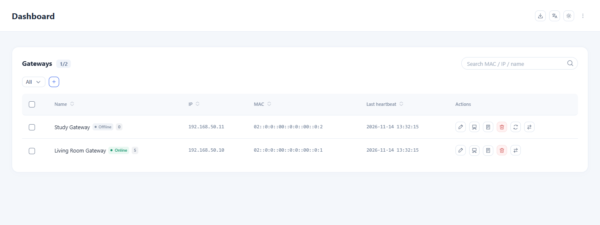
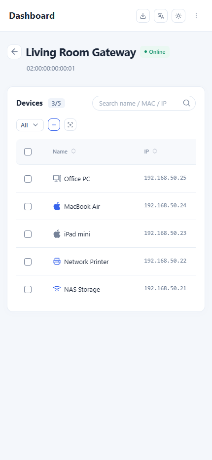

# WOL Gateway

WOL Gateway is a self-hosted ESP32-C3 and LAN device management system for homes and small offices. Gateways connect to the server over Wi-Fi to discover and monitor LAN devices. The system provides Wake-on-LAN, an optional Windows shutdown service, multi-user access control, device sharing, signed firmware OTA, and an offline deployment configurator.

The deployment configurator generates server configuration files locally in your browser. It does not upload hostnames, passwords, or keys.

## Features

- ESP32-C3 Wi-Fi provisioning, gateway pairing, LAN discovery, and presence monitoring.
- Multiple users, gateway ownership, access control, audit records, and device sharing.
- Wake-on-LAN; the optional Windows service reports PC presence and supports shutdown.
- Signed firmware verification, remote OTA, and rollback after failed updates.
- SQLite for local development, MySQL for deployment, and MQTT for gateway-to-server communication.

## Repository Layout

| Path | Contents |
| --- | --- |
| `app/` | FastAPI application, templates, and static assets |
| `firmware/` | ESP32-C3 firmware source and build configuration |
| `windows-agent/native/` | Windows WOL shutdown service source |
| `deploy/setup.html` | Offline deployment configurator |
| `tools/package_release.py` | Creates a sanitized source archive |

Prebuilt firmware, Windows executables, databases, production configuration, signing private keys, and internal operations records are excluded from the source archive. The OTA verification certificate is public material, not a signing key. Configure your own server address and trust certificate, and keep your signing private key secure.

## Run Locally

Requires Python 3.10+, Node.js for frontend tests, and an accessible MQTT broker. Configure the MQTT and database environment variables, then run:

    py -m venv .venv
    .venv\Scripts\python.exe -m pip install -r requirements.txt
    $env:DEBUG = 'false'
    $env:MQTT_HOST = '127.0.0.1'
    $env:MQTT_PORT = '1883'
    .venv\Scripts\python.exe run.py

Open `http://127.0.0.1:8088/setup` on first run to set the administrator password. SQLite can be used for local development. Before deployment, configure a dedicated database account, MQTT ACLs, HTTPS, and non-debug mode. Never commit real configuration, databases, device binding secrets, MQTT passwords, TLS private keys, or firmware signing private keys.

## Deployment Configurator

Open `deploy/setup.html` in a browser. Enter the deployment domain, database, and MQTT settings to download server environment variables, MySQL credentials, and systemd examples. Inputs remain in the current page's memory; the configurator makes no network requests and does not log into or execute commands on a server. Review `deploy/README.md` for file permissions, TLS, reverse proxy, and firewall setup.

Configure your own server domain in the firmware and Windows service source before building. Public source archives replace the original server address with `YOUR_SERVER_HOST`; use your own trust certificate and OTA signing key.

## Build and Test

After installing development dependencies, run Python unit tests and Node tests:

The local debugging, build, and packaging tools use Python 3.15.2; firmware builds use ESP-IDF 6.1. Run `C:\Python315\python.exe firmware/build.py --install-python-environment` once to install IDF's constrained Python dependencies. Builds use `firmware/build-idf61/`, isolated from earlier IDF builds; see `firmware/README.md` for overrides and signing. This toolchain migration does not change the website server's Python runtime requirements.

    .venv\Scripts\python.exe -m pip install -r requirements-dev.txt
    .venv\Scripts\python.exe -m unittest discover -s tests -v
    node --test tests/portal_flow.test.cjs tests/gateway_pairing.test.cjs
    C:\Python315\python.exe firmware/build.py

Build the Windows service with `windows-agent/native/Build.ps1`. Verify hardware flashing, service installation, shutdown, and remote deployment separately in their target environments.

## License

This project is licensed under GNU Affero General Public License v3.0 or later; see `LICENSE`. Attribution details are in `NOTICE`. Retain the original author and copyright notices. When distributing modified versions, add prominent notices to modified files or a change log shipped with the source, including what changed and when. Provide the complete corresponding source under AGPL terms. If you offer a modified version as a network service, provide its corresponding source to those users. Commercial use, modification, and redistribution are permitted subject to the source and license requirements.

Check the licenses of dependencies, fonts, icons, certificates, and other third-party components separately. This project's license does not cover third-party materials.

简体中文说明见 [README.zh-CN.md](README.zh-CN.md)。
