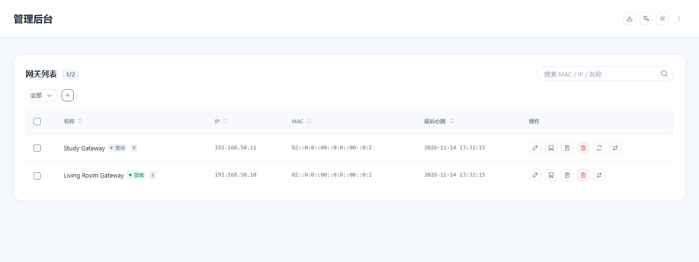
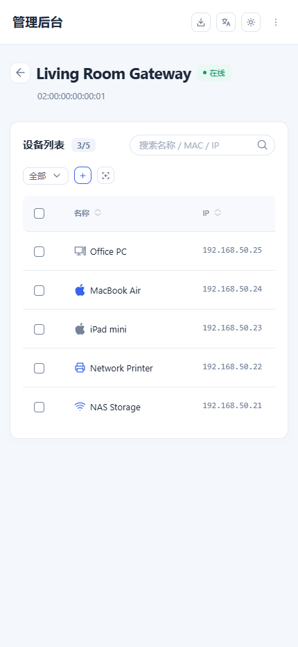
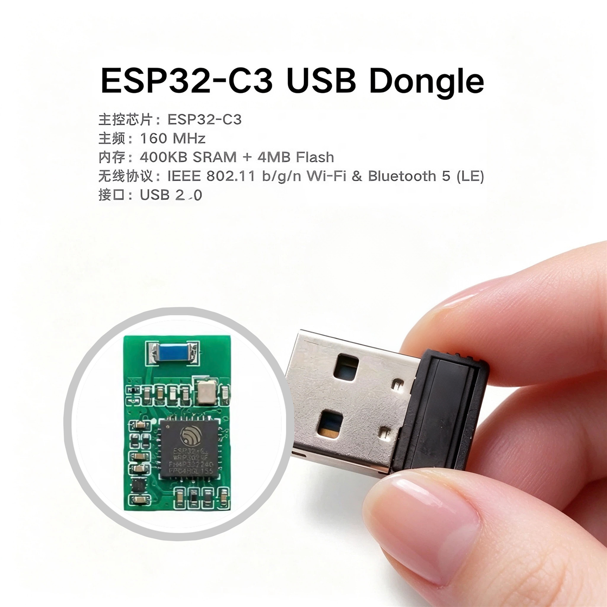

# WOL Gateway

[English](README.md) | 简体中文

面向家庭和小型办公室的 ESP32-C3 局域网设备管理系统。网关通过 Wi-Fi 接入服务端，扫描和监测局域网设备，并提供 Wake-on-LAN 唤醒、Windows 关机服务、多用户权限、设备分享和固件远程 OTA。

部署配置向导只在浏览器本地生成配置文件，不会上传主机名、密码或密钥。

## 功能

- ESP32-C3 Wi-Fi 配网、网关配对、局域网扫描和在线状态监测。
- 多用户、网关归属、权限控制、审计记录及设备分享。
- Wake-on-LAN 唤醒；可选 Windows 服务提供电脑在线状态和关机能力。
- 固件签名验证、远程 OTA 与失败回滚。
- SQLite 本地开发、MySQL 部署；MQTT 用于网关与服务端通信。

## 自用硬件

目前自用的是下图这款 ESP32-C3 USB 小型网关，配备 4 MB Flash。图片展示了外壳和内部电路板。

## 目录

| 路径 | 内容 |
| --- | --- |
| `app/` | FastAPI 应用、网页模板和静态资源 |
| `firmware/` | ESP32-C3 固件源码和构建配置 |
| `windows-agent/native/` | Windows WOL 关机服务源码 |
| `deploy/setup.html` | 离线部署配置向导 |
| `tools/package_release.py` | 生成脱敏源码发布 ZIP |

预构建固件、Windows EXE、数据库、生产配置、签名私钥和内部运维记录不会进入源码发布包。OTA 验签证书是公开证书，不是签名私钥。请配置自己的服务器域名和信任证书，并妥善保管签名私钥。

## 本地运行

需要 Python 3.10+、前端测试所需的 Node.js，以及可访问的 MQTT Broker。配置 MQTT 和数据库环境变量后运行：

    py -m venv .venv
    .venv\Scripts\python.exe -m pip install -r requirements.txt
    $env:DEBUG = 'false'
    $env:MQTT_HOST = '127.0.0.1'
    $env:MQTT_PORT = '1883'
    .venv\Scripts\python.exe run.py

首次打开 `http://127.0.0.1:8088/setup` 设置管理员密码。纯本地开发可使用 SQLite；部署前请配置独立数据库账号、MQTT ACL、HTTPS 证书和非调试运行模式。不要提交真实配置、数据库、设备绑定密钥、MQTT 密码、TLS 私钥或固件签名私钥。

## 部署配置向导

用浏览器打开 `deploy/setup.html`。填写部署域名、数据库和 MQTT 参数后，可下载生成的服务端环境变量、MySQL 凭据文件和 systemd 示例。输入只保存在当前页面内存中，向导不会发起网络请求、登录服务器或执行远程命令。安装服务前请阅读 `deploy/README.md`，检查文件权限、TLS、反向代理和防火墙。

编译固件和 Windows 服务前，请配置自己的服务器域名。公开源码包会将项目原有服务器地址替换为 `YOUR_SERVER_HOST`；请同时使用自己的信任证书和 OTA 签名密钥。

## 构建与测试

安装开发依赖后，可运行 Python 单元测试和 Node 测试：

本机调试、构建及打包工具使用 Python 3.15.2，固件构建使用 ESP-IDF 6.1。首次执行 `C:\Python315\python.exe firmware/build.py --install-python-environment` 安装 IDF 约束的 Python 依赖；后续输出位于 `firmware/build-idf61/`，不复用旧版 IDF 缓存。路径配置与签名打包见 `firmware/README.md`。此次迁移不改变网站服务器的 Python 运行环境要求。

    .venv\Scripts\python.exe -m pip install -r requirements-dev.txt
    .venv\Scripts\python.exe -m unittest discover -s tests -v
    node --test tests/portal_flow.test.cjs tests/gateway_pairing.test.cjs
    C:\Python315\python.exe firmware/build.py

Windows 服务可使用 `windows-agent/native/Build.ps1` 构建。硬件刷写、服务安装、关机及远程部署需在目标环境单独验证。

## 许可证

本项目采用 GNU Affero General Public License v3.0 or later，详见 `LICENSE`。署名要求见 `NOTICE`。请保留原作者和版权声明；分发修改版本时，在修改过的文件或随源码发布的变更记录中显著注明修改内容和日期，并按 AGPL 提供完整对应源码。通过网络向用户提供修改版服务时，也需向这些用户提供对应源码。允许商业使用、修改和再分发，但须遵守源码提供及相同许可证条款。

依赖、字体、图标、证书及其他第三方组件的许可需另行检查；本项目许可证不覆盖第三方材料。

